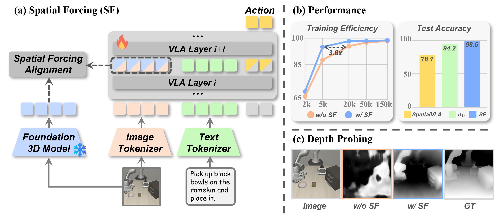

<p align="center">
  <picture>
    
  </picture>
</p>


<h3 align="center">
🌟 <b>SLA (Spatial-Language-Action Model) <a href="https://arxiv.org/abs/2611.08373">Paper</a></b> · <b><a href="https://embodiedsla.github.io/">Project-Page</a></b> · <b><a
href="https://huggingface.co/collections/haofuly/sla-collection">Hugging-Face</a></b>
</h3>

<h3 align="center">
🌟 <b>SF (Spatial Forcing) <a href="http://arxiv.org/abs/2510.12276">Paper</a></b> · <b><a href="https://spatial-forcing.github.io/">Project-Page</a></b> · <b><a
href="https://huggingface.co/collections/haofuly/spatial-forcing">Hugging-Face</a></b>
</h3>

<table align="center">
<tr><td>

> The core work of these projects is led by [Fuhao Li](https://haofuly.github.io/) and [Wenxuan Song](https://songwxuan.github.io/) . 
> For communication, We provide [WeChat Group](https://github.com/OpenHelix-Team/Spatial-Forcing/issues/17).

</td></tr>
</table>


## :loudspeaker: News!
- **[Soon]** We plan to release SLA v2 arXiv, with formal version instead of SLA-Preview on Robodojo and RoboCasa365 results and checkpoints.
- **[2026/11/07]** We released SLA on [ArXiv](https://arxiv.org/abs/2611.08373).
- **[2026/07/07]** We got the first place on the generalization dimension and second place on the average of all 5 dimensions of the comprehensive embodied leaderboard [RoboDojo](https://robodojo-benchmark.com/).
- **[2026/01/27]** Spatial Forcing is accepted by ICLR 2026!🎉
- **[2025/10/28]** We released our codes based on Pi_0 in real world! Everyone is welcome to use it!🎉
- **[2025/10/24]** 🏆 Congradulations to Jialong! He and our SF got the **second place** in **Agibot World Challenge** as well as 5000$ prize💰!
- **[2025/10/18]** Spatial Forcing won the 🥇**first place** in the [daily list](https://huggingface.co/papers/2510.12276) and 🥉**third place** in the [weekly list](https://huggingface.co/papers/week/2025-W42) in HF! ⭐
- **[2025/10/12]** We released Spatial Forcing on [ArXiv](http://arxiv.org/abs/2510.12276).

<!-- ## 🌟 Key Features of Spatial-Forcing (SF)

1. **Universality**: SF is a **plug-and-play** 3D finetune strategy that can be seamlessly integrated with any VLA training process, requiring only **30 lines** of code modifications. It substantially enhances spatial reasoning and manipulation capabilities. We provide implementations based on **OpenVLA** and **Pi0**, along with a **quick-start guide** for adapting SF to other VLA models.

2. **Strong Performance**: SF achieves **state-of-the-art (SOTA)** results on both **LIBERO** and **RoboTwin** benchmarks.  
In real-world experiments involving complex spatial structures, SF improves task success rates by **up to 50%**.

3. **Efficient Training**: SF requires only **3% of the training steps** or **5% of the training data** to reach a 66% success rate on LIBERO-Long. Moreover, it achieves strong real-world performance with as few as **20 demonstrations**.


## 📃 Overview


Our Spatial-Forcing (SF) model aligns the intermediate visual embeddings of VLAs with geometric representations produced by pretrained 3D foundation models. This alignment demonstrates enhanced performance, training efficiency, and data effificency. -->


## 🚀 Get Started
> SLA has become a superior replacement for Spatial Forcing. We recommand to use SLA in most cases.
- (SLA) To reproduce SLA simulation and real-world results and deployments, ref to our [SLA folder](SLA).

- (Spatial Forcing) To reproduce SF simulation results, ref to our [openvla-SF folder](openvla-SF).

- (Spatial Forcing) To deploy SF policy in real-world robots, ref to our [openpi-SF folder](openpi-SF).


## 🌏 Contact
For further discussion and collaboration, please feel free to contact us via Email and WeChat:

| Author | Email | WeChat |
|:---:|:---:|:---:|
| Fuhao Li | fli481@connect.hkust-gz.edu.cn | haofuly |
| Wenxuan Song | songwenxuan0115@gmail.com | swx0757 |

## ❤️ Acknowledgement
We thank these great works and open-source codebases: [OpenVLA-OFT](https://github.com/moojink/openvla-oft) & [OpenPI](https://github.com/Physical-Intelligence/openpi) & [VGGT](https://github.com/facebookresearch/vggt) & [REPA](https://github.com/sihyun-yu/REPA) & [OmniVGGT](https://github.com/Livioni/OmniVGGT-official).


## 🖊 Citation
If you find this work useful, please cite:

```bibtex
@article{sla2026,
  title     = {SLA: Scaling Spatial-Language-Action Model via Continual Pre-training},
  author    = {Li, Fuhao and Song, Wenxuan and Huang, Qizhou and Zhou, Ziyang and Wang, Jingbo and E, Junwu and Wang, Pengwei and Wang, Yan and Zhou, Shunbo and Li, Haoang},
  journal   = {arXiv preprint arXiv:2611.08373},
  year      = {2026}
}
@article{spatialforcing2025,
  title     = {Spatial Forcing: Implicit Spatial Representation Alignment For Vision-Language-Action Model},
  author    = {Li Fuhao, Song Wenxuan, Zhao Han, Wang Jingbo, Ding Pengxiang, Wang Donglin, Zeng Long, Li Haoang},
  journal   = {arXiv preprint arXiv:2510.12276},
  year      = {2025},
}
```
